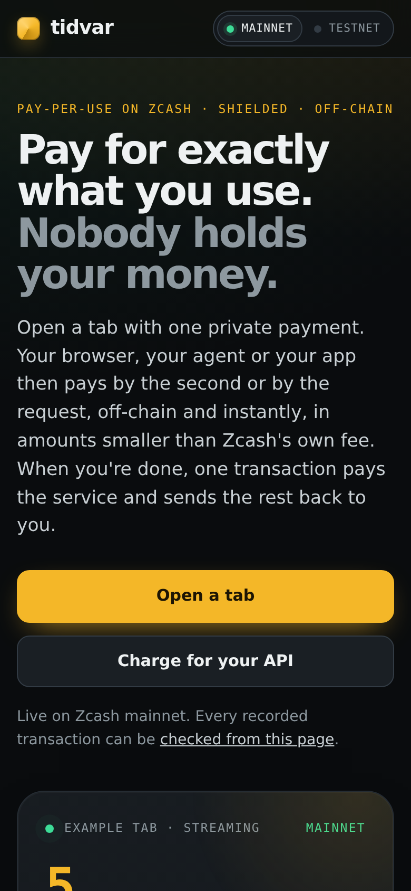
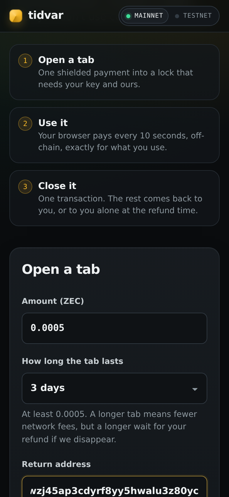
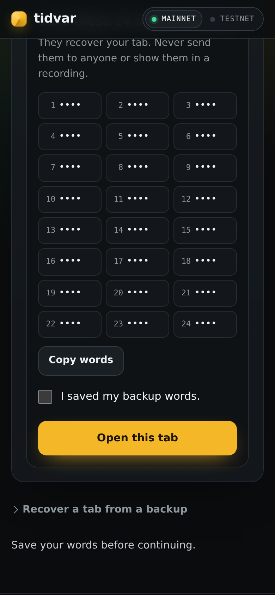
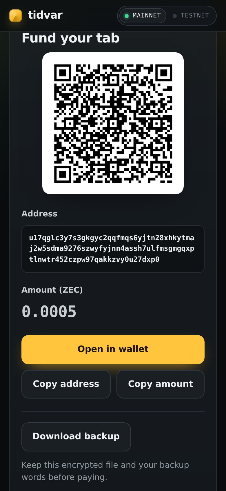

<p align="center"></p>

<h1 align="center">Tidvar</h1>

<p align="center"><b>Pay for exactly what you use, in private Zcash. Nobody holds your money.</b></p>

<p align="center">
<a href="https://tidvar.site">Mainnet app</a> ·
<a href="https://tidvar.38-49-216-59.sslip.io">Testnet app</a> ·
<a href="https://tidvar.site/check">Check it yourself</a> ·
<a href="docs/protocol.md">Protocol</a> ·
<a href="docs/security.md">Threat model</a> ·
<a href="docs/kit.md">Developer kit</a>
</p>

You open a **tab** with one ordinary shielded payment from any Zcash wallet. Your browser, your AI agent or
your app then pays the service **off-chain, instantly, by the second or by the request**, in amounts far
smaller than Zcash's own network fee. When you're done, **one shielded transaction** pays the service exactly
what you used and sends the rest back to you. If the service ever disappears, you take everything back
alone at the refund time. Hundreds of payments; two transactions on chain.

It is a payment channel on Zcash with no change to Zcash itself, and it is live on **mainnet** today with
three uses: a VPN paid by the second, any HTTP API paid per request, and AI agents with a hard budget.

> **Judges, start here (3 minutes).** Open the [mainnet app](https://tidvar.site)
> and scroll the landing page. Then press **Check it yourself** in the header: it re-fetches every recorded
> transaction from a public Zcash server and recomputes its id in your browser, no keys needed. Want to pay?
> Use the **Testnet** switch in the header and a faucet; everything works the same with free TAZ.

| Landing | Open a tab | Backup words | Fund it from any wallet |
|---|---|---|---|
|  |  |  |  |

## Why a tab

A minute of VPN is worth about 10 zatoshi. One ordinary Zcash payment costs 10,000 zatoshi in fees. Paying
by the minute, by the answer or by the API call with ordinary transactions costs a thousand times more in fees
than the thing being bought, and a prepaid account means the service holds your money. A tab removes both.

| | Ordinary payments | A Tidvar tab |
|---|---|---|
| Fees for 400 payments | 4,000,000 zat | 20,000 zat (one open, one close) |
| Smallest payment | the 10,000 zat fee alone | 1 zat (6 seconds of VPN) |
| Speed | about 75 s per block | instant: signed on your device, checked by the service |
| Who holds the money | you, or the service if prepaid | a lock that needs both keys; unused value returns to you |
| What the chain sees | every payment | two shielded transactions, shaped like 86.5% of mainnet Ironwood traffic |

## What runs today

| Use | How it is paid | Try it |
|---|---|---|
| **VPN** | by the second (1 zat / 6 s), kept paid 1, 8 or 24 hours ahead so a locked phone keeps it on; Pause, Resume, Close | the [app](https://tidvar.site/open) and the standard WireGuard app |
| **Any HTTP API** | per request, any price per path, through a proxy in front of an existing API (no code change); every 402 speaks **x402 v2** | live: an unmodified llama.cpp server's OpenAI chat API at `/llm/v1/chat/completions`, 1,000 zat a call |
| **AI agents** | the agent funds its own tab once; the tab's size and a per-request cap are limits no prompt can raise; CLI or **MCP** tool | `tidvar-agent` (below) |
| **Tidvar Chat** | 1,000 zat per answer, from the same tab | in the app |

## Proof

Every run is a real transaction on the public chain, listed in `evidence/` and re-checked by
`tidvar verify` and by the browser check page.

**Mainnet**

| Run | What happened | Transactions |
|---|---|---|
| 03 | **An AI agent paid an API on its own.** A general-purpose AI assistant, with `tidvar-agent` as its MCP tool, paid the live OpenAI-compatible model API at `tidvar.site/llm` twice (1,000 zat each) from a tab funded once with 0.0006 ZEC. With a 500 zat per-request cap, the next call was refused before paying: "This route asks 1000 zat, above the 500 zat limit for one request." The close paid exactly **2,000 zat** and returned **48,000 zat**. | [funding](https://blockchair.com/zcash/transaction/7c10e79fd5b83cdff8cb2e3b6e6d8113f88ed293f9a42c5122b97d7469c4cfee) · [close](https://blockchair.com/zcash/transaction/b3cf35ad83700837bbc71373aabbab0a634f294f6c4b34a20753479365cd4aee) (block 3,533,862) |
| 02 | An Android phone opened a 0.0005 ZEC tab and paid it from Zingo. It used the VPN for 12 minutes, kept paid 8 hours ahead, paused and resumed it, and asked Tidvar Chat one question. The close paid the service exactly **1,120 zat** (1,000 for the answer, 120 for VPN time) and returned **38,880 zat** to the payer's Zodl wallet. | [funding](https://blockchair.com/zcash/transaction/a4ec513db55853ba0b895ca7254238f0efc6cbd0994a9123b4e6fc4139f3854b) · [close](https://blockchair.com/zcash/transaction/ec29f3018a7b1e9e2bc73651b15e8bece5ddff032ea7ed8a56929e0aea4a90b7) (block 3,533,841) |
| 01 | A phone tab with the VPN connected; the watchtower, a separate process holding no keys, published the tab's close on its own and returned 39,993 zat. | [funding](https://blockchair.com/zcash/transaction/c00483ad876a3103cbb1b29e41f8570c0c187c073b4f1179fd51fcdc6a2ea75f) · [close](https://blockchair.com/zcash/transaction/ffb745da6f1e17ca60004783093d999ca3f9c71e974ada728a7c4c71fe24038f) (block 3,533,748) |

**Testnet: 18 tabs, 37 transactions**, every way a tab can end:

| Ending | Runs | What happened |
|---|---|---|
| Cooperative close | 13 | VPN on an Android phone, desktop Chrome and Firefox; chat; a paid API; an agent paying an OpenAI-compatible API over x402; a VPN kept paid 8 hours ahead |
| Forced close | 1 | The payer left; at its closing deadline the service closed alone with the newest signed amount |
| Refund | 2 | The service never answered; after the refund time the browser signed the refund alone |
| Watchtower | 1 | The service was stopped; the watchtower published its close |
| Top-up and renew | 1 + 1 | A tab paid past its first payment's limit after a top-up, then rolled into a new tab in one transaction |

VPN cut-off after payments stop: 12.8–27.8 s, measured on an Android phone, desktop Chrome and Firefox.

```sh
cargo install --git https://github.com/Jennycruzy/tidvar tidvar-cli
tidvar verify --network mainnet
tidvar verify --network testnet
```

## How a tab works

1. **Open.** Your device and the service run FROST distributed key generation for a new Ironwood address that
   neither can spend alone. The service seals its key share to a future drand round, the tab's refund time,
   and your device checks 32 of 64 sealed pieces before you pay. You fund the address from any wallet.
2. **Pay.** Every 10 seconds (or per request) your device signs an IOU: a complete shielded transaction
   paying the service the running total and you the rest, with your half of the signature. The service checks
   it against the chain, keeps only the newest and serves you. Nothing goes on chain.
3. **Close.** Together, one transaction pays the service what you used. If you vanish, the service closes alone
   with your newest IOU; if it is down, a watchtower holding no keys publishes that close. If the service
   vanishes, drand opens its sealed share at the refund time and your device refunds you alone.

```
 wallet ──1 payment──▶ tab address (2-of-2)                    service
                          │                                       │
 device ── IOU every 10 s (signed running total, off-chain) ────▶ │ checks, keeps newest, serves
                          │                                       │
                          └── close: 1 transaction ─▶ service gets what you used, you get the rest
                              or refund alone after the time seal opens
```

## Who sees what

| | Sees | Never sees |
|---|---|---|
| **The public chain** | Two shielded transactions per tab | Amounts, parties, that a tab existed, how many payments happened |
| **The service** | This tab's payments and their times; your IP address, as any VPN does | Who you are, your wallet balance, your other addresses; your key, so it can't take more than you signed |
| **The public Zcash server** | Our relay asking for whole block ranges | Your IP address; which notes are yours (your device decrypts them) |
| **The watchtower** | Finished close transactions | Keys, shares, nonces, the service database |

We measured the shape of mainnet Ironwood traffic (`tidvar measure`, 9,716 transactions in 2,000 blocks,
`evidence/mainnet/privacy/`): 86.5% have exactly 2 actions, like a Tidvar open and close, and the most common
expiry gap is the 40 blocks a cooperative close uses.

| Not claimed | Why |
|---|---|
| Anonymity from the service at the IP level | A VPN service always sees your IP |
| Unlinking the payments inside one tab | They belong to one tab by design: open a new tab per session to split them |
| Protection if drand's threshold of operators colludes to publish early | The time seal relies on it |

## Who holds which key

| Key | Lives in | Can | Can never |
|---|---|---|---|
| Your key share and 24 backup words | your device, encrypted (AES-GCM) in IndexedDB and in your backup file | sign IOUs and, after the refund time, the refund alone | leave your device unencrypted |
| The service's key share | the service database (mode 600) | complete the newest IOU you signed | sign more than you signed, or anything alone before the refund time |
| The service's sealed share | encrypted to drand's future round | open at the refund time, for you | open early |
| Your return address | the signed tab record | receive your change at close or refund | be changed by the service |
| Agent tab key | `~/.tidvar-agent` (mode 600) | pay up to the tab's size and the per-request cap | exceed them |

## Attacks: what is refused

| Attack | Result | Shown by |
|---|---|---|
| The service takes more than you signed (forged payer share) | Aggregation fails | `at2_forged_payer_share_cannot_be_aggregated` |
| You refund before the refund time | The seal does not open; your share alone is not a signature | `at1_another_rounds_signature_cannot_stand_in_for_the_refund_round`, `at12_forged_round_signature_fails_bls_verification` |
| A rogue key in the setup | Setup aborts | `at7_rogue_dkg_package_aborts_the_setup` |
| A message from one tab presented for another | Refused | `at13_message_for_one_tab_is_refused_for_another` |
| Using the VPN after payments stop | Internet cut in 12.8–27.8 s; the tunnel stays up so the page can still pay or close | testnet runs 02–07, mainnet run 02 |
| Closing a tab twice / refunding a closed tab | Rejected by the network's nullifier rule; the page explains | the service and page checks |
| An agent asked to pay more than its limits | Refused before signing: the per-request cap and the tab's size | mainnet run 03; testnet runs 14 and 17 |
| Malformed messages | 486 million fuzz inputs across 8 decoders, 0 crashes | `crates/tidvar-core/fuzz` |

## Developer kit

Put an existing API behind tab payments, without changing it:

```sh
TIDVAR_UPSTREAM=http://127.0.0.1:3000 TIDVAR_ROUTES='/api/search=3000,/api/*=500' tidvar-kit-demo
```

Or price a route inside an axum service:

```rust
let paywall = tidvar_402::Paywall::with_routes(&store, &offer, vec![("/api/*".into(), 500)])?;
let app = Router::new().route("/api/answer", get(answer)).layer(from_fn_with_state(paywall, tidvar_402::charge));
```

An unpaid request gets `402 Payment Required` with `Tidvar-Price` and an x402 v2 `PAYMENT-REQUIRED` header
(scheme `tidvar-tab`). The payer signs a charge on its tab and retries with `Tidvar-Request` or x402
`PAYMENT-SIGNATURE`; the charge and the signed reply are one database transaction, so a retry is never
charged twice.

An agent with a hard budget, from a shell or as an MCP tool in any MCP client:

```sh
tidvar-agent open --service https://tidvar.site --amount 0.0005 --return <your address>
tidvar-agent fetch https://tidvar.site/llm/v1/chat/completions \
  --data '{"messages":[{"role":"user","content":"What is a payment channel?"}]}'
tidvar-agent close
node packages/tidvar-agent/agent.mjs mcp   # tab_status, ask, fetch_paid, close_tab
```

In the browser: `await tab.fetchPaid(url, progress, {method, body}, maxPrice)`. Full reference:
[docs/kit.md](docs/kit.md).

## Engineering decisions

- **No consensus change.** The lock is a FROST 2-of-2 key over one Ironwood note. Every payment is an
  unproven transaction plus a signature share, so it costs milliseconds; only the close is proven.
- **The refund is a time seal, not a script.** Zcash has no shielded time locks, so the service's share is
  encrypted to a drand round (tlock) with a cut-and-choose check, and your device rebuilds the full key
  after that round.
- **Two network upgrades at once.** Mainnet runs NU6.3 and testnet already runs NU7; every transaction uses
  the consensus branch of its target height, and IOUs switch automatically when NU7 activates.
- **The device is the wallet.** Compact blocks are decrypted on your device through our relay; keys, IOUs
  and backups never leave it unencrypted.
- **Exactly once.** Each request is saved before it is sent and the service keeps its exact reply, so a retry
  after a dropped connection never pays or charges twice.
- **A VPN that can't trap you.** A paused or unpaid tunnel stays connected but cut off from the internet, so
  the page can always reach the service to resume, pay or close with WireGuard on.

## Build and check

```sh
rustup target add wasm32-unknown-unknown
cargo build --workspace --release --locked
cargo test --workspace --locked
cargo clippy --workspace --all-targets --locked -- -D warnings
npm ci --prefix packages/tidvar-web --ignore-scripts && npm ci --prefix web --ignore-scripts
npm run build:wasm --prefix packages/tidvar-web && npm run build --prefix packages/tidvar-web
npm run build --prefix web
```

Running a service: [operations](docs/operations.md).

| Directory | What it does |
| --- | --- |
| `crates/tidvar-core` | Joint keys, signing, transaction checks, amounts, deadlines, message hashes |
| `crates/tidvar-seal` | The time-sealed share and its check |
| `crates/tidvar-chain` | Light-client transport, note decryption, witnesses, broadcast |
| `crates/tidvar-payer` | The payer's signing state and backups (native and WebAssembly) |
| `crates/tidvar-payee` | The service's shares, payment checks, ledger and proofs |
| `crates/tidvar-402`, `services/kit-demo` | The paywall layer (per-path prices, x402 v2) and the proxy for any HTTP API |
| `crates/tidvar-cli` | `tidvar verify`, `measure`, `send-refund` |
| `services/api`, `services/vpn`, `watch` | The service, the WireGuard controller, the watchtower |
| `packages/tidvar-web`, `packages/tidvar-agent`, `web` | The browser kit, the agent, the app |

## Licence and security

MIT or Apache-2.0 ([LICENSE-MIT](LICENSE-MIT), [LICENSE-APACHE](LICENSE-APACHE)); third-party notices in
[THIRD_PARTY_NOTICES.md](THIRD_PARTY_NOTICES.md). Security reports: [SECURITY.md](SECURITY.md).
